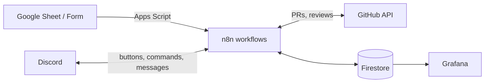

# MentorFlow

MentorFlow is a Discord bot built on n8n that takes routine work off the mentor of a student team project. It announces pull requests that are ready for review, reminds people about meetings, collects feedback and shows analytics. The mentor configures everything directly in Discord.

Topic: *A platform for automating mentoring and collecting feedback based on cloud services* (Lviv Polytechnic National University).

## How it works

The team keeps code on GitHub, tasks in a Google Sheet, talks in Discord and meets in Zoom. The bot connects these tools:

- **PR review** — a task moves to `Ready for Review` in the sheet, and the bot posts a card for its PR that mentions the right team. Reactions show the PR state, and the card can be resent after 12 hours without a review.
- **Meeting reminders** — reminder cards 30 and 5 minutes before a meeting mention its participants and link the Zoom call. People who can't attend leave a status, and the bot posts a summary when the meeting starts.
- **Feedback** — a Google Form at the end of each sprint feeds Firestore and a Grafana dashboard; very negative feedback is sent to the mentor right away.
- **Mentor panel** — the `/mentor` command manages meetings, templates, announcements, settings, access and a calendar subscription (`.ics`).



## Tech stack

Discord · n8n · Firebase Firestore · Google Sheets / Forms + Apps Script · GitHub GraphQL API · Grafana · Docker Compose

## Quick start

Requirements: Node.js 24 and n8n 2.x.

```bash
npm test          # unit tests
npm run e2e       # real n8n against mocked Discord, GitHub and Firestore
npm run build     # build workflows/*.json for import into n8n
```

Copy `.env.example` to `.env` and fill it in. `npm run env:firebase -- <service-account.json>` writes the Firebase key into `.env`. See the [development guide](docs/guides/development.md) for importing workflows and the required n8n settings.

## Status

| Part | Status |
|---|---|
| Discord router, PR review, meeting reminders | implemented and tested with mocks; live run pending |
| Mentor panel | not started |
| Feedback, analytics, calendar export, infrastructure | not started |

Task-level progress: [docs/tasks](docs/tasks/README.md).

## Documentation

- [Overview](docs/overview.md) — principles, roles, architecture, technologies
- [Features](docs/features/) — specifications
- [Data schemas](docs/schema/README.md) — Firestore collections, the contracts between parts
- [Guides](docs/guides/README.md) — setup, development, usage
- [Tasks and progress](docs/tasks/README.md)
- [Decisions and open questions](docs/decisions.md)
