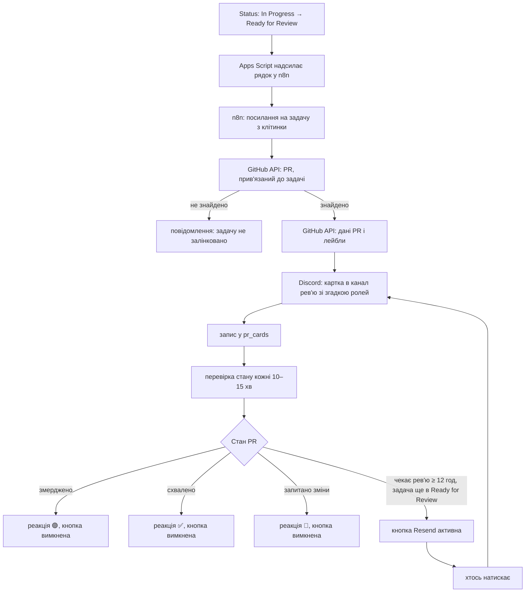

# Фіча 1. PR на рев'ю

← [Огляд](../overview.md) · власник: Роман · таски: [roman.md](../tasks/roman.md)

> [!NOTE]
> Коли задача в Google Таблиці переходить з `In Progress` у `Ready for Review`, бот знаходить її PR на GitHub і публікує в канал рев'ю картку зі згадкою команди, яка має його рев'ювати. Далі бот стежить за станом PR: показує його реакцією і дозволяє перевідправити картку, якщо за 12 годин PR ніхто не відрев'ював.

## Вихідні дані

**Таблиця задач (Google Sheets).** Рядок = задача, 4 колонки:

| № | Колонка | Що в ній | Чи використовує бот |
|---|---|---|---|
| 1 | Назва | назва задачі, яка водночас є посиланням на задачу в GitHub (одна клітинка) | так: назва + посилання |
| 2 | Story points | оцінка задачі | ні |
| 3 | Duration | тривалість | ні |
| 4 | Status | `Not started`, `In Progress`, `Ready for Review` або `Done` | так: тригер |

**GitHub.** Задача описана в репозиторії. Автор PR прив'язує задачу в описі PR (наприклад, `Closes #17`), і GitHub пов'язує задачу й PR в обидва боки. Так за задачею можна знайти її PR. Лейбли PR визначають, кого згадати.

**Discord.** Канал для рев'ю PR (умовно `pr-review`).

## Тригер

Статус задачі змінюється **з `In Progress` на `Ready for Review`**. Інші переходи бот ігнорує. Перехід у `Done` чи назад в `In Progress` враховується лише в регулярній перевірці: така картка більше не перевідправляється.

> [!TIP]
> Тригер реалізує Apps Script у самій таблиці (installable `onEdit`). Скрипт помічає зміну в колонці Status, і якщо нове значення `Ready for Review`, а попереднє `In Progress`, надсилає в n8n рядок: назву задачі, посилання з клітинки, номер рядка й секрет. Подія приходить миттєво, і n8n не потрібна Google-авторизація.

## Флоу



1. **Подія з таблиці**: назва задачі, посилання на задачу, номер рядка.
2. **Пошук PR.**
   - З посилання визначити репозиторій і номер задачі.
   - Через GitHub API знайти PR, що посилається на цю задачу.
   - Якщо PR кілька, брати найновіший відкритий. Чернетки (draft) не беруться.
   - Якщо PR немає — повідомлення «не залінковано», і на цьому все.
3. **Дані PR**:
   - назва і посилання;
   - автор: GitHub-нікнейм і аватар;
   - кількість доданих і видалених рядків;
   - лейбли;
   - стан: відкритий, змерджений чи закритий;
   - рішення рев'ю: схвалено, запитано зміни або чекає рев'ю.
4. **Картка** в канал рев'ю.
5. **Запис у `pr_cards`**:
   - id повідомлення й каналу;
   - PR і задача;
   - рядок таблиці;
   - час публікації;
   - стан.
6. **Регулярна перевірка** кожної активної картки: стан PR у GitHub і статус задачі в таблиці. За результатом оновлюються реакція й кнопка Resend.

## Картка PR

**Текст повідомлення** (згадки стоять у тексті, бо згадка всередині вбудованої картки не сповіщає):

> `@student-developer <author> opened a PR for review: <PR title>`

**Вміст картки:**
- назва PR;
- автор — GitHub-нікнейм і аватар;
- задача — назва задачі з таблиці;
- зміни: зелений `+N` і червоний `−M` рядків. Звичайний текст Discord не фарбує, тому використовується блок коду ` ```diff `: рядки з `+` він показує зеленим, з `-` — червоним.

**Кнопки — три в один ряд, саме в такому порядку:**

| Ліва | Середня | Права |
|---|---|---|
| **Open task** — посилання на задачу | **Resend** — активна тільки за правилами нижче, інакше сіра | **Open PR** — посилання на PR |

## Кого згадувати (лейбли)

Бот згадує команду, яка відповідає за PR, за його **лейблами на GitHub**. Відповідність «лейбл → роль» ментор задає в налаштуваннях ([фіча 4](04-mentor-panel.md)). Стартова відповідність:

| Лейбл PR | Згадка |
|---|---|
| `dev` | `@student-developer` |
| `qa` | `@student-qa` |
| `qc` | `@student-qc` |
| `devops` | `@student-devops` |
| `design` | `@student-designer` |

- Кілька лейблів — згадуються всі відповідні ролі.
- На PR немає жодного відомого лейбла — бот бере лейбли задачі. Немає і там — згадується роль за замовчуванням із налаштувань (`@student-developer`).

## Задачу не залінковано

Якщо задача перейшла в `Ready for Review`, а PR до неї не знайдено, бот публікує в канал рев'ю:

> ⚠️ `Task "<task title>" is in Ready for Review, but no PR is linked to it.` + кнопка **Open task**

Автор додає в PR посилання на задачу (`Closes #17`) і знову переводить задачу з `In Progress` у `Ready for Review`.

## Стани PR

| Стан PR | Реакція на картці | Resend |
|---|---|---|
| чекає рев'ю, минуло < 12 год | — | недоступна |
| чекає рев'ю, минуло ≥ 12 год, задача ще в `Ready for Review` | — | **доступна** |
| запитано зміни (Changes Requested) | 🔁 | недоступна, доки PR знову не чекатиме рев'ю |
| схвалено (Approved) | ✅ | недоступна |
| змерджено | 🟣 | недоступна, картку більше не перевіряємо |
| закрито без мерджу або задача пішла з `Ready for Review` | — | недоступна, картку більше не перевіряємо |

Немає реакції — PR ще на рев'ю і потребує уваги. Є реакція — дивитися вже не треба.

> [!NOTE]
> Discord не вміє сам «увімкнути кнопку через 12 годин». Бот робить її активною, коли редагує своє повідомлення під час регулярної перевірки. При натисканні бот ще раз перевіряє умови, тож навіть неактуальна кнопка нічого не зламає.

## Resend

1. Кнопка активна, коли:
   - від публікації минуло 12 годин;
   - PR досі чекає рев'ю: не схвалено, без Changes Requested, не змерджено;
   - задача досі в `Ready for Review`.
2. Натиснути може **будь-хто**. Бот повторно перевіряє умови й публікує в той самий канал нову картку з актуальними даними.
3. Для нової картки відлік 12 годин починається спочатку. **Стару картку бот видаляє**: свої повідомлення він може видаляти без додаткових прав. Якщо видалити не вдалося, на старій просто вимикається кнопка.

## Компоненти

| Компонент | Що робить |
|---|---|
| Apps Script у таблиці | тригер `In Progress → Ready for Review`, надсилає рядок у n8n |
| n8n: webhook «задача на рев'ю» | приймає подію, перевіряє секрет, витягує посилання на задачу |
| n8n: пошук PR | GitHub API: PR за задачею, дані PR, лейбли |
| n8n: «не залінковано» | повідомлення в канал рев'ю, якщо PR не знайдено |
| n8n: публікація картки | згадки ролей за лейблами, картка з трьома кнопками |
| Firestore | колекція `pr_cards` |
| n8n: регулярна перевірка | раз на 10–15 хв оновлює реакції й доступність Resend |
| n8n: обробник Resend | перевірка умов → нова картка → видалення старої |

Права бота в каналі рев'ю: перегляд каналу, надсилання повідомлень, вбудовані картки, реакції, історія повідомлень.

## Відкриті питання

- Точні назви лейблів у репозиторії (`dev` чи `developers`, `devops`…).
- Остаточні емодзі станів (зараз ✅ / 🟣 / 🔁).
- Чи потрібен TL;DR змін від LLM — див. [decisions.md](../decisions.md).
