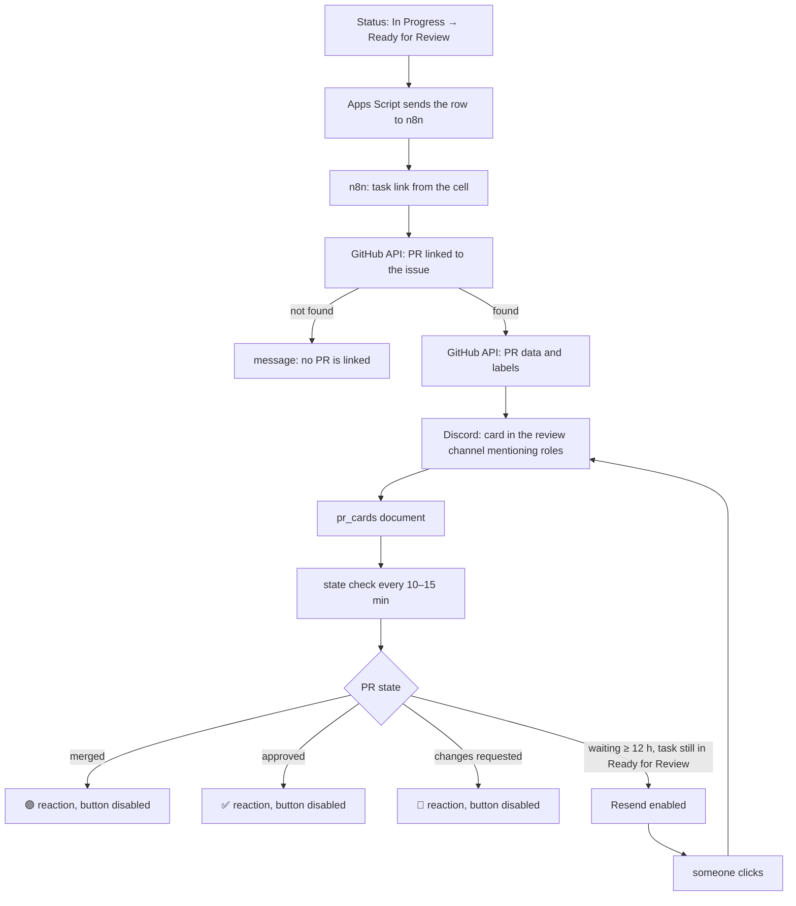

# Feature 1. PR review

← [Overview](../overview.md) · [Tasks](../tasks/README.md)

> [!NOTE]
> When a task in the Google Sheet moves from `In Progress` to `Ready for Review`, the bot finds its PR on GitHub and posts a card to the review channel that mentions the team that should review it. The bot then tracks the PR: it shows the state as a reaction and lets anyone resend the card if nobody reviewed the PR within 12 hours.

## Inputs

**Tasks sheet (Google Sheets).** One row is one task, 4 columns:

| # | Column | Contents | Used by the bot |
|---|---|---|---|
| 1 | Name | the task title, which is also a link to the GitHub issue (one cell) | yes: title + link |
| 2 | Story points | estimate | no |
| 3 | Duration | duration | no |
| 4 | Status | `Not started`, `In Progress`, `Ready for Review` or `Done` | yes: trigger |

**GitHub.** The task is an issue in the repository. The PR author links the issue in the PR description (for example, `Closes #17`), and GitHub links the issue and the PR both ways, so the PR can be found from the issue. PR labels decide whom to mention.

**Discord.** A channel for PR review (`pr-review`).

## Trigger

The task status changes **from `In Progress` to `Ready for Review`**. Other transitions don't publish anything. A move to `Done` or back to `In Progress` only updates the existing card: it is no longer checked or resent.

> [!TIP]
> The trigger is an Apps Script in the sheet (installable `onEdit`). It sends every Status change to n8n with the task title, the link from the cell, the row number and a secret. The event arrives instantly, and n8n needs no Google authorization.

## Flow



1. **Sheet event**: task title, task link, row number.
2. **PR lookup.**
   - Get the repository and issue number from the link.
   - Find PRs that reference the issue through the GitHub API.
   - With several PRs, take the newest open one. Drafts are skipped.
   - No PR → a "not linked" message, and nothing else.
3. **PR data**:
   - title and link;
   - author: GitHub login and avatar;
   - added and deleted lines;
   - labels;
   - state: open, merged or closed;
   - review decision: approved, changes requested or waiting.
4. **The card** in the review channel.
5. **A `pr_cards` document**: message and channel IDs, PR and task, sheet row, publish time, state.
6. **A periodic check** of every active card: the PR state on GitHub and the last task status from the sheet. The reaction and the Resend button are updated from the result.

## PR card

**Message text** (mentions are in the text because a mention inside an embed doesn't notify):

> `@student-developer <author> opened a PR for review: <PR title>`

**Card contents:**
- PR title;
- author — GitHub login and avatar;
- task — the task title from the sheet;
- changes: green `+N` and red `−M` lines. Plain Discord text has no colours, so a ` ```diff ` code block is used: it shows `+` lines in green and `-` lines in red.

**Buttons — three in one row, in this order:**

| Left | Middle | Right |
|---|---|---|
| **Open task** — link to the task | **Resend** — enabled only by the rules below, grey otherwise | **Open PR** — link to the PR |

## Whom to mention (labels)

The bot mentions the team responsible for the PR by its **GitHub labels**. The mentor sets the label → role map in the settings ([feature 4](04-mentor-panel.md)). Until then the map comes from the role IDs in the environment:

| PR label | Mention | Variable |
|---|---|---|
| `dev` | `@student-developer` | `DEVELOPER_ROLE_ID` |
| `qa` | `@student-qa` | `STUDENT_QA_ID` |
| `qc` | `@student-qc` | `STUDENT_QC_ID` |
| `devops` | `@student-devops` | `DEVOPS_ROLE_ID` |
| `design` | `@student-designer` | set in the mentor panel |

- Several labels — all matching roles are mentioned.
- No known label on the PR — the task labels are used. None there either — the default role from the settings (`DEFAULT_PR_ROLE_ID`).

## Task not linked

If a task moved to `Ready for Review` and no PR was found, the bot posts to the review channel:

> ⚠️ `Task "<task title>" is in Ready for Review, but no PR is linked to it.` + an **Open task** button

The author adds the issue link to the PR (`Closes #17`) and moves the task from `In Progress` to `Ready for Review` again.

## PR states

| PR state | Reaction | Resend |
|---|---|---|
| waiting for review, < 12 h passed | — | disabled |
| waiting for review, ≥ 12 h passed, task still in `Ready for Review` | — | **enabled** |
| changes requested | 🔁 | disabled until the PR waits for review again |
| approved | ✅ | disabled |
| merged | 🟣 | disabled, the card is no longer checked |
| closed without merge, or the task left `Ready for Review` | — | disabled, the card is no longer checked |

No reaction means the PR still needs attention. A reaction means nobody needs to look at it anymore.

> [!NOTE]
> Discord can't "enable a button after 12 hours" by itself. The bot enables it by editing its message during the periodic check. On click the bot checks the conditions again, so an outdated button breaks nothing.

## Resend

1. The button is enabled when:
   - 12 hours have passed since publishing;
   - the PR is still waiting for review: not approved, no changes requested, not merged;
   - the task is still in `Ready for Review`.
2. **Anyone** can click it. The bot checks the conditions again and posts a new card with current data to the same channel.
3. The 12-hour countdown restarts for the new card. **The bot deletes the old card**: it can delete its own messages without extra permissions. If deleting fails, the button on the old card is just disabled.

## Components

| Component | What it does |
|---|---|
| Apps Script in the sheet | sends every Status change to n8n |
| n8n `mfPrTaskEvents` | checks the secret, finds the PR, posts the card or the "not linked" message |
| n8n `mfPrStateCheck` | every 10 min updates reactions and Resend |
| n8n `mfPrInteractions` | Resend: re-check → new card → delete the old one |
| Firestore | the `pr_cards` collection |

Bot permissions in the review channel: view channel, send messages, embed links, add reactions, read message history.

## Open questions

- Exact label names in the repository (`dev` or `developers`, `devops`…).
- Final state emojis (currently ✅ / 🟣 / 🔁).
- Whether to add an LLM TL;DR of changes — see [decisions.md](../decisions.md).
