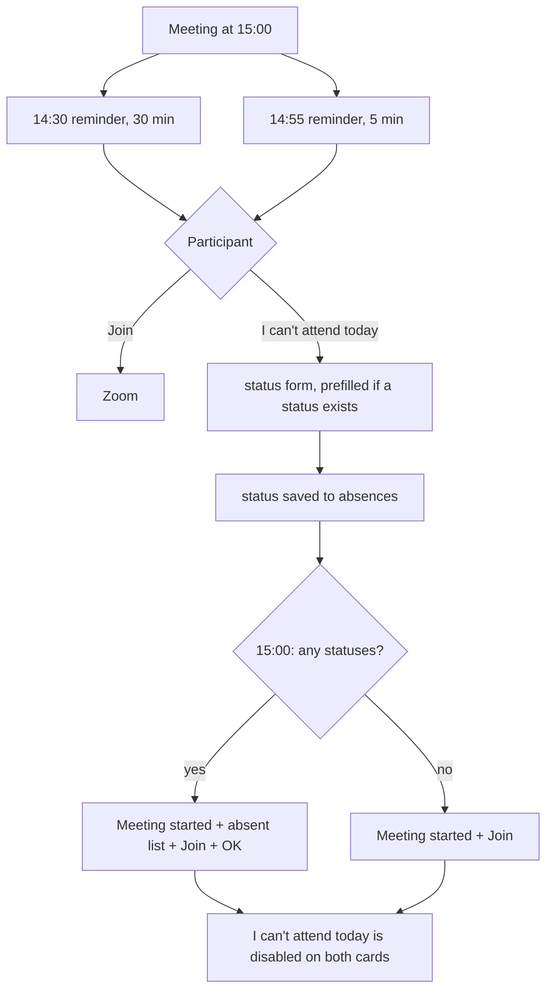

# Feature 2. Meeting reminders

← [Overview](../overview.md) · [Tasks](../tasks/README.md)

> [!NOTE]
> Meetings happen in Zoom. Before every meeting the bot posts a reminder card to Meetings twice, 30 and 5 minutes before the start: it mentions the people who should attend and links the Zoom call. People who can't come leave a status with the "I can't attend today" button. When the meeting starts, the bot posts a summary of the statuses.

The mentor sets the schedule, participants and templates in the bot menu — [feature 4](04-mentor-panel.md).

## Meeting data

One meeting is one day and one event.

| Field | Required | Example |
|---|---|---|
| start date and time | yes | Monday, 15:00 |
| participants | yes | `@mentor`, `@student-developer`, `@Andrii` |
| Zoom link | yes | `https://zoom.us/j/…` |
| reminder offsets | yes, 30 and 5 min by default | 30, 5 |
| title | no | General Meeting |
| description | no | Sprint demo discussion |

**Participants can be given in three ways**, and the bot turns them into Discord mentions:
1. picking roles and people from a list;
2. text with `@`: `@student-developer, @Andrii`;
3. plain comma-separated names: `student-developer, Andrii, Olena`. The bot looks up a role or a server member with that name. Anything not found or ambiguous is shown to the mentor while configuring.

> [!NOTE]
> - Looking up server members by name requires the Server Members Intent in the Developer Portal.
> - A mention notifies a person only in the message text. A mention inside an embed doesn't notify.

## Reminder card

The card is posted twice, 30 and 5 minutes before the start: for a 15:00 meeting that is 14:30 and 14:55. It goes to Meetings: a channel or a thread.

**Message text** (the mentions are here):

> `@mentor @student-developer! Meeting starts in about 30 minutes`
>
> `@mentor @student-developer! Meeting starts in about 5 minutes`

**The card under the text:**
- the title, if set;
- the description, if set;
- the start time in Discord's timestamp format, shown to everyone in their own time zone, plus a relative "in 30 minutes";
- "Marked absent: N" when someone has already left a status.

**Buttons:**

| Left | Right |
|---|---|
| **Join** — the Zoom link | **I can't attend today** — opens the status form |

## "I can't attend today"

1. **Anyone** can click it. A form with one Status field opens, as in scrum: what is done, what is in progress, blockers, why you won't be there.
2. The bot replies with a message only that person sees: "Saved, your status will be shown when the meeting starts".
3. The status belongs to the meeting (meeting + date), not to the card. If someone left a status on the 30-minute card, the form on the 5-minute card opens prefilled. The status can be changed.

## Meeting start

At the start time the bot replies to the 5-minute card with one of two messages.

**Someone left a status** — the summary from both cards:

> **Meeting started. Absent today (2):**
> `@Olena` — finished the login form, fixing validation today, no blockers
> `@Andrii` — sick, PR #42 is waiting for review
>
> buttons: **Join** · **OK**

- The status author is shown as a mention of their Discord account: it is clickable and opens the profile, but sends no notification (`allowed_mentions` is empty). The bot keeps no separate data about people.
- **OK** confirms "statuses read" instead of emoji reactions. After a click, "Seen by `@Mentor`" appears under the summary. Anyone can click, and the line shows who did.

**Nobody left a status** — no mentions:

> **Meeting started**
>
> button: **Join**

After the start, "I can't attend today" is disabled on both cards.

## Flow

## Components

| Component | What it does |
|---|---|
| n8n `mfReminderTick` | every minute finds meetings with a reminder or start due (taking `meeting_exceptions` into account), posts reminders and the start message, disables the absence buttons |
| n8n `mfReminderInteractions` | the status form → `absences` → a reply only the user sees; OK → "Seen by" |
| Firestore | reads `meetings`, `meeting_exceptions`; writes `absences`, `meeting_occurrences` |

Duplicates are prevented by `meeting_occurrences`: each posted reminder and the start are recorded there, so a restart or a missed minute doesn't post twice. A reminder more than 10 minutes late is skipped.

## Open questions

- How long to keep statuses: delete after the meeting (minimal data) or keep them for attendance statistics.
