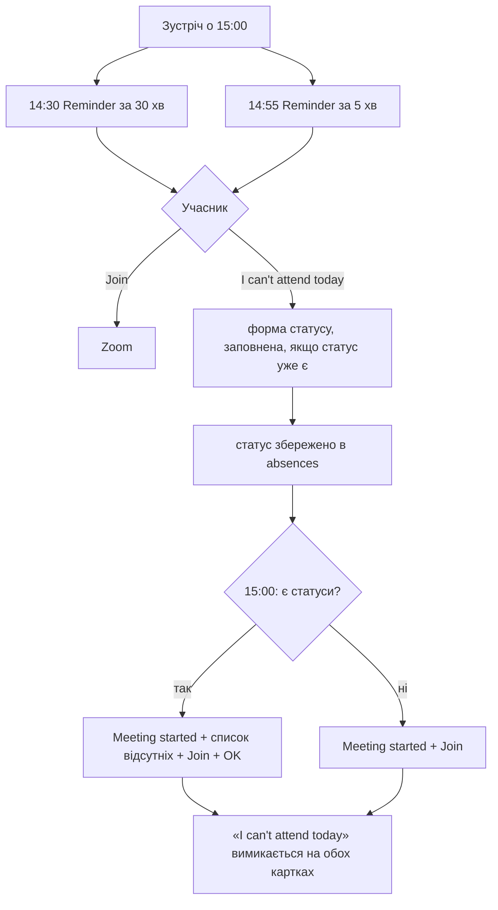

# Фіча 2. Нагадування про зустрічі (Reminder)

← [Огляд](../overview.md) · власник: Роман · таски: [roman.md](../tasks/roman.md)

> [!NOTE]
> Зустрічі проходять у Zoom. Перед кожною зустріччю бот двічі — за 30 і за 5 хвилин — публікує в розділ Meetings картку Reminder: згадує тих, хто має бути, і дає кнопку на Zoom. Хто не зможе прийти, залишає статус через кнопку «I can't attend today». На старті зустрічі бот публікує зведення статусів.

Розклад, учасників і шаблони ментор налаштовує в меню бота — [фіча 4](04-mentor-panel.md).

## Вихідні дані однієї зустрічі

Одна зустріч — це один день і одна подія.

| Поле | Обов'язкове | Приклад |
|---|---|---|
| дата й час початку | так | понеділок, 15:00 |
| учасники | так | `@mentor`, `@student-developer`, `@Roman` |
| посилання на Zoom | так | `https://zoom.us/j/…` |
| за скільки нагадувати | так, за замовчуванням 30 і 5 хв | 30, 5 |
| назва | ні | General Meeting |
| опис | ні | Sprint demo discussion |

**Учасників можна задати трьома способами**, і бот зводить їх до згадок Discord:
1. вибір ролей і людей зі списку;
2. текстом з `@`: `@student-developer, @Roman`;
3. просто через кому: `student-developer, Roman, Olena`. Бот шукає роль або учасника сервера з такою назвою. Якщо щось не знайдено або знайдено кілька варіантів, бот показує це ментору ще під час налаштування.

> [!NOTE]
> - Щоб шукати учасників сервера за іменем, у Developer Portal потрібно увімкнути Server Members Intent.
> - Згадка сповіщає людину лише тоді, коли стоїть у тексті повідомлення. Згадка всередині вбудованої картки не сповіщає.

## Картка Reminder

Картка публікується двічі — за 30 і за 5 хвилин до початку. Для зустрічі о 15:00 це 14:30 і 14:55. Місце — розділ Meetings: окремий канал або гілка в каналі.

**Текст повідомлення** (тут стоять згадки):

> `@mentor @student-developer! Meeting starts in about 30 minutes`
>
> `@mentor @student-developer! Meeting starts in about 5 minutes`

**Картка під текстом:**
- назва, якщо задана;
- опис, якщо заданий;
- час початку у форматі Discord — кожен бачить його у своєму часовому поясі, плюс відлік «in 30 minutes».

**Кнопки:**

| Ліва | Права |
|---|---|
| **Join** — посилання на Zoom | **I can't attend today** — відкриває форму статусу |

Пропозиція: на картці за 5 хвилин показувати рядок «Marked absent: 2».

## Кнопка «I can't attend today»

1. Натиснути може **будь-хто**. Відкривається форма з одним полем Status, як у скрамі: що зроблено, що в роботі, які блокери, чому не буде.
2. Бот відповідає повідомленням, яке бачить лише той, хто натиснув: «Saved, your status will be shown when the meeting starts».
3. Статус зберігається для зустрічі (зустріч + дата), а не для картки. Якщо людина залишила статус на картці за 30 хв, на картці за 5 хв форма відкриється вже заповненою. Статус можна змінити.

## Старт зустрічі

У час початку бот публікує відповіддю на картку за 5 хв одне з двох повідомлень.

**Хтось відмітився** — зведення статусів з обох карток:

> **Meeting started. Absent today (2):**
> `@Olena` — finished the login form, fixing validation today, no blockers
> `@Andrii` — sick, PR #42 is waiting for review
>
> кнопки: **Join** · **OK**

- Автор статусу показаний згадкою його Discord-акаунта: вона клікабельна й веде на профіль. Сповіщення ця згадка не надсилає — це вимкнено через `allowed_mentions`. Окремих даних про людей бот не зберігає.
- **OK** — підтвердження «статуси прочитано» замість емодзі-реакцій. Після натискання під зведенням з'являється «Seen by `@Mentor`». Натиснути може будь-хто, у рядку видно, хто саме.

**Ніхто не відмітився** — без згадок:

> **Meeting started**
>
> кнопка: **Join**

Після старту кнопка «I can't attend today» вимикається на обох картках.

## Флоу

## Компоненти

| Компонент | Що робить |
|---|---|
| n8n: планувальник | щохвилини шукає в `meetings` зустрічі, для яких настав час нагадування або старту (з урахуванням `meeting_exceptions`) |
| n8n: публікація Reminder | текст зі згадками, картка, дві кнопки |
| n8n: обробник «I can't attend today» | форма статусу → `absences` → відповідь, яку бачить лише користувач |
| n8n: старт зустрічі | «Meeting started» зі зведенням або без |
| n8n: обробник OK | дописує «Seen by @…» |
| Firestore | читає `meetings`, `meeting_exceptions` (схема Насті); пише `absences` |

## Відкриті питання

- Скільки зберігати статуси: видаляти після зустрічі (мінімум даних) чи лишати для статистики відвідуваності на дашборді.
