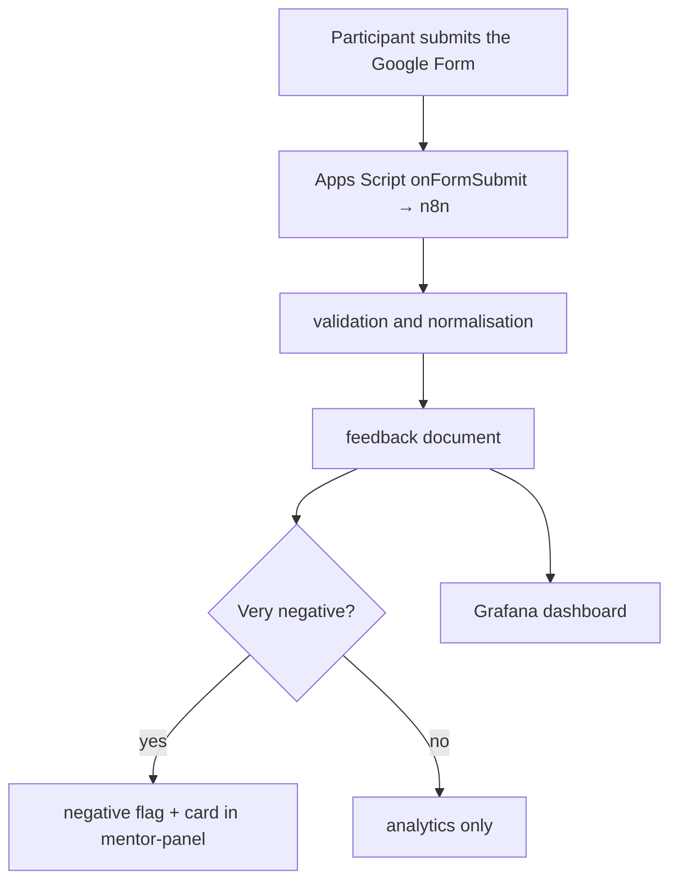

# Feature 3. Feedback

← [Overview](../overview.md) · [Tasks](../tasks/README.md)

> [!NOTE]
> Participants rate the project, processes, tasks, team and mentor and write what to improve. Responses go to Firestore, and the mentor sees statistics on a Grafana dashboard. For very negative feedback the bot immediately sends the mentor a card in Discord. Anonymity is the participant's choice.

## When it is filled in

At the end of each sprint the bot posts a message with the form link to General. The mentor sets the sprint end date in the settings ([feature 4](04-mentor-panel.md)). The link has the project and sprint prefilled, so the dashboard shows the trend by sprint.

## Form fields

A Google Form with 4 sections.

### 1. About you

| Field | Type | Required |
|---|---|---|
| Role in the project | choice: Developer, Designer, QA, QC, DevOps, Architect, Other | yes |
| Full name | short text | no — empty means anonymous |
| Project / sprint | prefilled from the link, hidden | — |

The role is required: without it ratings of different roles can't be compared, and it doesn't reveal the person.

### 2. Ratings

A grid, each row on a 1–5 scale (1 — very bad, 5 — excellent), all required:

| # | Criterion | Question |
|---|---|---|
| 1 | Processes | how convenient and well set up the scrum processes are: dailies, reviews, planning |
| 2 | Architecture | how well thought out the project architecture is |
| 3 | Task interest | how interesting the tasks were |
| 4 | Growth | how much the project improved your skills |
| 5 | Team | satisfaction with the team |
| 6 | Mentor | satisfaction with the mentor |
| 7 | Project overall | overall satisfaction with the project |

Separately, outside the grid:

| Field | Type | Required |
|---|---|---|
| Task difficulty | choice: too easy / just right / too hard | yes |
| Would you recommend such a project to friends? | 0–10 scale (NPS) | no |

Difficulty is separate because this scale has no "good" or "bad", so it isn't mixed with the 1–5 ratings.

### 3. Open questions

Long text, all optional:
1. What did you like most?
2. What should be improved in the project?
3. What should be improved in the processes?
4. Ideas for future projects.
5. General comment.

### 4. Contact

| Field | Type | Required |
|---|---|---|
| May we contact you? | No / Yes, to discuss the feedback / Yes, send me offers (internships, courses) / Yes, both | yes |
| Email or Discord name | short text | yes, shown only after a "Yes…" |

- Google Forms branching: after "No" the form ends, after any "Yes" a required contact field appears.
- The question says: "If you leave a contact, your feedback is no longer anonymous".
- Google email collection is off.

## Processing a response

1. **Receiving.** The form's Apps Script (`onFormSubmit`) sends the response to n8n immediately.
2. **Validation and normalisation.** Ratings in range, role from the list. Without a name and contact the response is stored as anonymous.
3. **A `feedback` document.**
4. **Very negative feedback** — at least one of (the mentor changes the thresholds in the settings):
   - the average of the seven ratings ≤ 2.0;
   - "Team", "Mentor" or "Project overall" = 1.
5. **A card in `mentor-panel`:**
   - "⚠️ Negative feedback", date, project and sprint;
   - role; name or "anonymous";
   - the seven ratings (1–2 highlighted), difficulty, NPS;
   - the open answers (long ones shortened);
   - the contact, if the participant allowed it;
   - an "Open dashboard" button.

## Mentor dashboard (Grafana)

| Panel | Shows |
|---|---|
| summary | number of responses, share of anonymous ones, average rating, NPS |
| by criterion | average and 1–5 distribution for each of the seven criteria |
| difficulty | share of "easy / just right / hard" |
| trend | average ratings and NPS by sprint |
| by role | average ratings per role |
| negative feedback | table of responses flagged negative |
| what to improve | latest open answers |
| contacts | who agreed to be contacted or to receive offers |

Only the mentor sees the dashboard.

> [!WARNING]
> Grafana doesn't read Firestore out of the box; it needs the community Firestore data source plugin, which must be checked early. If it doesn't fit, the fallback is: n8n writes daily aggregates to a Google Sheet, and the dashboard is built in Looker Studio.

## Components

| Component | What it does |
|---|---|
| Google Form | 4 sections, rating grid, branching, hidden project/sprint field |
| Form Apps Script | `onFormSubmit` → n8n webhook |
| n8n: feedback intake | validation, normalisation, `feedback` document |
| n8n: negative detector | rules from `settings` → negative flag |
| n8n: mentor card | message in `mentor-panel` |
| n8n: form mailing | message with the link on the sprint end date |
| Grafana | the panels above |

## Not in the first version

- New rating criteria.
- Feedback classification and sentiment analysis with an LLM.
