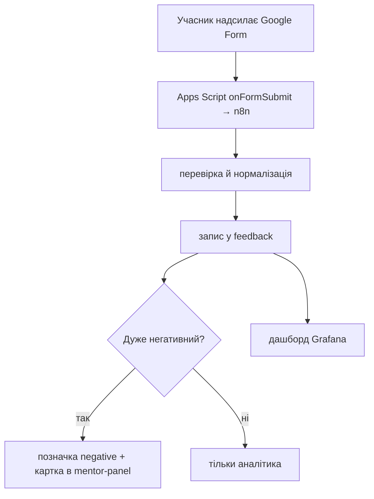

# Фіча 3. Зворотний зв'язок

← [Огляд](../overview.md) · власник: Богдан · таски: [bohdan.md](../tasks/bohdan.md)

> [!NOTE]
> Учасники оцінюють проєкт, процеси, задачі, команду й ментора і пишуть, що покращити. Відповіді потрапляють у Firestore, і ментор бачить статистику на дашборді Grafana. Про дуже негативний відгук бот одразу надсилає ментору картку в Discord. Анонімність — на вибір учасника.

## Коли заповнюють

Наприкінці кожного спринту бот публікує в General повідомлення з посиланням на форму. Дату кінця спринту ментор задає в налаштуваннях ([фіча 4](04-mentor-panel.md)). У посиланні вже заповнені проєкт і спринт, тож на дашборді видно динаміку по спринтах.

## Поля форми

Форма — Google Forms, 4 розділи.

### 1. Про тебе

| Поле | Тип | Обов'язкове |
|---|---|---|
| Роль у проєкті | вибір: Developer, Designer, QA, QC, DevOps, Architect, Other | так |
| Ім'я та прізвище | короткий текст | ні — порожньо = анонімно |
| Проєкт / спринт | заповнюється з посилання, прихований | — |

Роль обов'язкова: без неї не порівняти оцінки різних ролей, а людину вона не розкриває.

### 2. Оцінки

Сітка, кожен рядок за шкалою 1–5 (1 — дуже погано, 5 — чудово), усі обов'язкові:

| № | Критерій | Що питаємо |
|---|---|---|
| 1 | Процеси | наскільки зручні й добре налаштовані scrum-процеси: дейліки, рев'ю, планування |
| 2 | Архітектура | наскільки продумана архітектура проєкту |
| 3 | Цікавість задач | наскільки цікаво було працювати над задачами |
| 4 | Користь для розвитку | наскільки проєкт прокачав навички |
| 5 | Команда | задоволеність командою |
| 6 | Ментор | задоволеність ментором |
| 7 | Проєкт загалом | загальна задоволеність проєктом |

Окремо, не в сітці:

| Поле | Тип | Обов'язкове |
|---|---|---|
| Складність задач | вибір: занадто легкі / в самий раз / занадто складні | так |
| Чи порекомендуєш такий проєкт знайомим? | шкала 0–10 (NPS) | ні |

Складність винесено окремо: на цій шкалі немає «добре» чи «погано», тому її не змішують з оцінками 1–5.

### 3. Відкриті питання

Довгий текст, усі необов'язкові:
1. Що найбільше сподобалось?
2. Що покращити в проєкті?
3. Що покращити в процесах?
4. Ідеї для майбутніх проєктів.
5. Загальний коментар.

### 4. Зв'язок

| Поле | Тип | Обов'язкове |
|---|---|---|
| Чи можна з тобою зв'язатися? | Ні / Так, щоб обговорити відгук / Так, надсилайте пропозиції (стажування, навчання) / Так, обидва | так |
| Пошта або Discord-нік | короткий текст | так, але з'являється лише після «Так…» |

- Розгалуження Google Forms: після «Ні» форма завершується, після будь-якого «Так» з'являється обов'язкове поле контакту.
- Біля питання написано: «If you leave a contact, your feedback is no longer anonymous».
- Збір email-адрес у Google вимкнено.

## Обробка відповіді

1. **Отримання.** Apps Script форми (`onFormSubmit`) одразу надсилає відповідь у n8n.
2. **Перевірка й нормалізація.** Оцінки в діапазоні, роль зі списку. Без імені й контакту відгук зберігається як анонімний.
3. **Запис у `feedback`.**
4. **Дуже негативний відгук** — виконується хоча б одне (пороги ментор змінює в налаштуваннях):
   - середнє семи оцінок ≤ 2,0;
   - «Команда», «Ментор» або «Проєкт загалом» = 1.
5. **Картка в `mentor-panel`:**
   - «⚠️ Negative feedback», дата, проєкт і спринт;
   - роль; ім'я або «anonymous»;
   - сім оцінок (1–2 виділені), складність, NPS;
   - тексти відкритих питань (довгі — скорочено);
   - контакт, якщо учасник дозволив;
   - кнопка «Open dashboard».

## Дашборд ментора (Grafana)

| Панель | Що показує |
|---|---|
| загальне | кількість відгуків, частка анонімних, середня оцінка, NPS |
| за критеріями | середнє й розподіл 1–5 по кожному з семи критеріїв |
| складність | частка «легко / в самий раз / складно» |
| динаміка | середні оцінки й NPS по спринтах |
| за ролями | середні оцінки для кожної ролі |
| негативні відгуки | таблиця відгуків з позначкою negative |
| що покращити | останні тексти відкритих питань |
| контакти | хто погодився на зв'язок чи пропозиції |

Дашборд бачить тільки ментор.

> [!WARNING]
> Grafana не читає Firestore з коробки, потрібен плагін Firestore data source (community). Його треба перевірити на старті. Якщо не підійде, запасний варіант: n8n раз на день пише агрегати в Google Таблицю, а дашборд будується в Looker Studio.

## Компоненти

| Компонент | Що робить |
|---|---|
| Google Form | 4 розділи, сітка оцінок, розгалуження, приховане поле проєкту/спринту |
| Apps Script форми | `onFormSubmit` → webhook n8n |
| n8n: обробка відгуку | перевірка, нормалізація, запис у `feedback` |
| n8n: детектор негативу | правила з `settings` → позначка negative |
| n8n: картка ментору | повідомлення в `mentor-panel` |
| n8n: розсилка форми | повідомлення з посиланням у дату кінця спринту |
| Grafana | панелі з таблиці вище |

## Не в першій версії

- Нові критерії оцінки.
- Класифікація відгуків і оцінка тону тексту через LLM.
