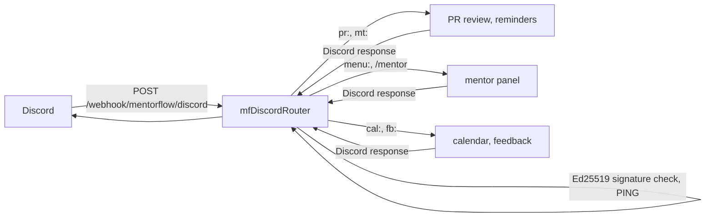

# Discord router

← [Guides](README.md) · code: `services/discord-router/`

A Discord application has only **one** Interactions Endpoint URL. So all bot actions (buttons, modals, slash commands) arrive at one workflow, `mfDiscordRouter`, which forwards each action to the workflow of the part that owns it.

## How the router picks the target

| What arrived | By | Target |
|---|---|---|
| button, select menu, modal | the `custom_id` prefix before the first `:` | `pr`, `mt` → PR review, reminders; `menu` → mentor panel; `cal`, `fb` → calendar, feedback |
| slash command, autocomplete | the command name | `mentor` → mentor panel |

The router sends `POST {MF_INTERNAL_URL}/mentorflow/internal/<target>` with the Discord interaction as the body and the header `X-MentorFlow-Secret: {MF_INTERNAL_SECRET}`.

## Plugging in a part

1. Create a workflow with a **Webhook**:
   - method `POST`;
   - path `mentorflow/internal/<target>` (`menu`, `cal` or `fb`);
   - Respond: **Using 'Respond to Webhook' Node**.
2. Check the secret first: the `x-mentorflow-secret` header must equal `$env.MF_INTERNAL_SECRET`, otherwise respond 403. `isInternalCall` in `services/discord-router/src/router.js` does this.
3. Return a Discord [interaction response](https://discord.com/developers/docs/interactions/receiving-and-responding#interaction-response-object) through **Respond to Webhook**:
   - `{ "type": 4, "data": { "content": "...", "flags": 64 } }` — a message only the user sees;
   - `{ "type": 7, "data": { ... } }` — update the message with the button;
   - `{ "type": 9, "data": { ...modal } }` — open a modal;
   - `{ "type": 5 }` / `{ "type": 6 }` — defer the reply when the work is long.
4. **Answer fast.** Discord waits 3 seconds, and the router gives the target workflow 2.5 s. Do long work after Respond to Webhook (the workflow keeps running) and show the result with `PATCH /webhooks/{DISCORD_BOT_ID}/{token}/messages/@original`.
5. The `custom_id` prefix of your components must match the target: `menu:…`, `cal:…`, `fb:…`. At most 100 characters.

If there is no workflow for a target yet, the user gets "This feature is not available yet.". If the workflow doesn't answer in time — "The bot is busy. Please try again.".

## Environment variables

| Variable | What |
|---|---|
| `DISCORD_BOT_PUBLIC_KEY` | the application's Public Key (General Information), for the signature check |
| `MF_INTERNAL_URL` | the base URL of n8n webhooks from inside, `http://localhost:5678/webhook` by default |
| `MF_INTERNAL_SECRET` | the shared secret of internal calls |

## Discord setup

Developer Portal → the application → General Information → **Interactions Endpoint URL** = `https://<public n8n address>/webhook/mentorflow/discord`. Discord checks the URL right away with a PING and a request with a wrong signature, so `mfDiscordRouter` must be active.
