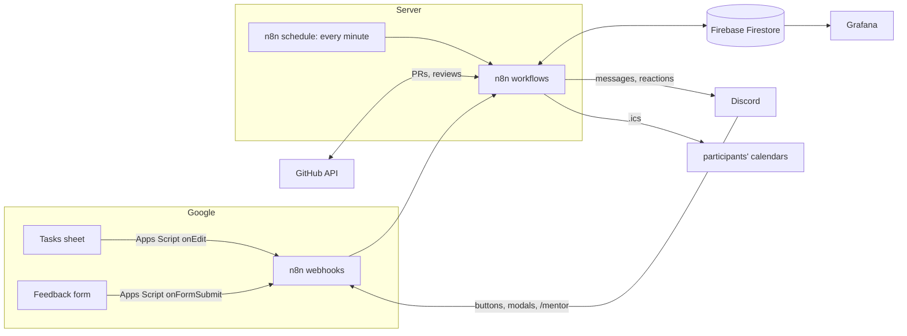

# MentorFlow — overview

> [!NOTE]
> A Discord bot on n8n that takes routine work off the mentor of a student team project: it announces PRs ready for review, reminds people about meetings, collects feedback and shows analytics. The mentor configures everything directly in Discord.

## Topic

**A platform for automating mentoring and collecting feedback based on cloud services.**

Official description: the system automates scheduling of regular mentoring sessions and syncs the schedule through Google Calendar. It delivers notifications and reminders to participants through a chat bot (Telegram or Discord) and email. The platform collects, validates and classifies feedback through dynamic forms. Student activity statistics and recurring problems are summarised in an analytics dashboard.

## What we build

A student team works on a project:
- code lives in a GitHub repository;
- tasks live in a Google Sheet with the statuses `Not started → In Progress → Ready for Review → Done`;
- communication happens in Discord;
- meetings happen in Zoom.

MentorFlow is a Discord bot that handles:
- announcing PRs ready for review and reminding about them again;
- meeting reminders that mention the right people and collect absence statuses;
- feedback collection and analytics for the mentor;
- configuration of all of the above by the mentor, inside Discord.

| Topic item | How it is covered |
|---|---|
| scheduling regular mentoring sessions | [feature 2](features/02-meeting-reminders.md) and [feature 4](features/04-mentor-panel.md) |
| syncing the schedule with Google Calendar | [feature 4](features/04-mentor-panel.md): an `.ics` subscription link per role |
| chat bot notifications | the Discord bot, features 1, 2, 4 |
| email notifications | not planned |
| dynamic forms, validation, classification | [feature 3](features/03-feedback.md): a validated form and negative-feedback rules |
| activity and problem dashboard | [feature 3](features/03-feedback.md) plus statistics from features 1 and 2 |

## Principles

- **Minimal personal data.** Discord roles define who is who. There is no separate member database and no registration.
- **The mentor configures everything in Discord** and does nothing by hand afterwards.
- **Bot messages are in English only**, including the mentor panel.

## Discord roles

| Role | Who |
|---|---|
| `mentor` | the project lead; has access to the bot menu |
| `architect` | an extra role for people responsible for architecture (can be in dev, QA, DevOps) |
| `student-developer` | developers |
| `student-designer` | designers |
| `student-qa` | testers (quality assurance) |
| `student-qc` | quality control |
| `student-devops` | infrastructure |

The bot mentions a role (`@student-developer`) to notify a team: on a PR card by the PR labels, in a reminder by the meeting participants.

## Features

| # | Feature | In short |
|---|---|---|
| 1 | [PR review](features/01-pr-review.md) | a task moves to `Ready for Review` → a PR card in the review channel mentioning the team; PR state as reactions; a Resend button after 12 h |
| 2 | [Meeting reminders](features/02-meeting-reminders.md) | reminder cards 30 and 5 min before with participant mentions and Zoom; an "I can't attend today" button with a status; a summary at the start |
| 3 | [Feedback](features/03-feedback.md) | a Google Form with ratings → Firestore → a Grafana dashboard; an alert to the mentor about very negative feedback |
| 4 | [Mentor panel](features/04-mentor-panel.md) | `/mentor`: meetings, templates, announcements, settings, access; calendar export |

## How it fits together

**Three kinds of events drive the bot:**
1. **External events.** A task moves to `Ready for Review` or a feedback form is submitted — Apps Script calls n8n immediately.
2. **Discord actions.** Buttons, modals, the `/mentor` command. Discord sends them to a single Interactions Endpoint in n8n, and the router forwards each action to its owner by prefix (see the [router guide](guides/discord-router.md)).
3. **Time.** n8n checks every minute whether a reminder or a meeting start is due; PR cards are checked every 10–15 minutes; the feedback form is sent on the sprint end date.

**Data lives in Firebase Firestore.** Grafana reads the same database. Collection schemas are in [schema/](schema/README.md).

| Collection | Stores | Part |
|---|---|---|
| `pr_cards` | a PR card: Discord message, PR, task, publish time, state | PR review |
| `absences` | an "I can't attend today" status: meeting, date, user, text | reminders |
| `meeting_occurrences` | one meeting of a series: posted reminders, start, "Seen by" | reminders |
| `meetings` | a meeting or series: type, days, time, participants, Zoom, reminders, template | mentor panel |
| `meeting_exceptions` | a moved or cancelled meeting of a series | mentor panel |
| `templates` | meeting templates | mentor panel |
| `announcements` | sent announcements | mentor panel |
| `settings` | channels, label → role map, thresholds, feature parameters | mentor panel |
| `access` | who besides the mentor can open the menu | mentor panel |
| `feedback` | form responses | feedback |
| `events` | bot activity log for the dashboard and diagnostics | feedback / analytics |

## Technologies

| Layer | Technology | Why |
|---|---|---|
| interface | **Discord** — a bot over the REST API and an Interactions Endpoint | cards, buttons, modals, slash commands, role mentions |
| logic | **n8n** (self-hosted) | webhooks, schedules, API calls; complex logic is tested JS in Code nodes |
| data | **Firebase Firestore** | a cloud database with nothing to deploy |
| tasks | **Google Sheets + Apps Script** | the `Ready for Review` trigger without Google authorization in n8n |
| code and PRs | **GitHub GraphQL API** (fine-grained token) | the PR of a task, changes, labels, review decision |
| feedback | **Google Forms + Apps Script** | a form with a rating grid and branching |
| analytics | **Grafana** + the Firestore data source plugin | feedback, PR and meeting dashboards |
| calendar | **iCalendar (`.ics`)** generated by n8n | a subscription link to a role's schedule |
| deployment | **Docker Compose** (n8n + Grafana) | the same locally and on a server; public HTTPS via a domain or a tunnel |

## Key decisions

The full list is in [decisions.md](decisions.md). The most important:
- **The trigger of feature 1 is the Google Sheet**, not a GitHub webhook.
- **The meeting schedule is configured only in Discord.** Google Calendar only receives an export.
- **Firestore instead of PostgreSQL:** Firebase is already available and needs no deployment.
- **No LLM in the first version.**
