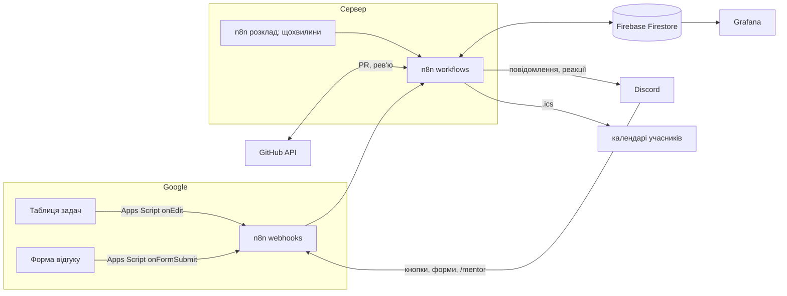

# MentorFlow — огляд

> [!NOTE]
> Discord-бот на n8n, який знімає з ментора командного студентського проєкту рутину: оголошує PR, готові до рев'ю, нагадує про зустрічі, збирає відгуки й показує аналітику. Ментор налаштовує все прямо в Discord.

## Тема

**Платформа автоматизації менторської діяльності та збору зворотного зв'язку на базі хмарних сервісів.**

Офіційний опис: система автоматизує планування регулярних менторських сесій і синхронізацію розкладу через Google Calendar. Вона доставляє сповіщення й нагадування учасникам через чат-бот (Telegram або Discord) та електронною поштою. Платформа збирає, валідує й класифікує зворотний зв'язок через динамічні форми. Статистика активності студентів і типові проблемні питання зводяться в аналітичний дашборд.

## Що робимо

Команда студентів працює над проєктом:
- код — у GitHub-репозиторії;
- задачі — у Google Таблиці зі статусами `Not started → In Progress → Ready for Review → Done`;
- спілкування — у Discord;
- зустрічі — у Zoom.

MentorFlow — Discord-бот, який бере на себе:
- оголошення PR, готових до рев'ю, і повторні нагадування про них;
- нагадування про зустрічі зі згадкою потрібних людей і статусами відсутніх;
- збір відгуків про проєкт і аналітику для ментора;
- налаштування всього цього ментором прямо в Discord.

| Пункт теми | Як покривається |
|---|---|
| планування регулярних менторських сесій | [фіча 2](features/02-meeting-reminders.md) і [фіча 4](features/04-mentor-panel.md) |
| синхронізація розкладу з Google Calendar | [фіча 4](features/04-mentor-panel.md): посилання-підписка `.ics` на розклад окремої ролі |
| сповіщення через чат-бот | Discord-бот, фічі 1, 2, 4 |
| сповіщення електронною поштою | не заплановано |
| динамічні форми, валідація, класифікація | [фіча 3](features/03-feedback.md): форма з валідацією, правила негативних відгуків |
| дашборд активності й проблемних питань | [фіча 3](features/03-feedback.md) + статистика фіч 1 і 2 |

## Принципи

- **Мінімум даних про людей.** Хто є хто, визначають ролі Discord. Окремої бази учасників і реєстрації немає.
- **Ментор налаштовує все в Discord** і далі нічого не робить вручну.
- **Мова повідомлень бота — англійська**, без двомовності. Меню ментора теж англійською.

## Ролі Discord

| Роль | Хто |
|---|---|
| `mentor` | керівник проєкту; має доступ до меню бота |
| `architect` | додаткова роль для тих, хто відповідає за архітектуру (може бути в dev, QA, DevOps) |
| `student-developer` | розробники |
| `student-designer` | дизайнери |
| `student-qa` | тестувальники (quality assurance) |
| `student-qc` | контроль якості (quality control) |
| `student-devops` | інфраструктура |

Згадку ролі (`@student-developer`) бот використовує, щоб сповістити потрібну команду: на картці PR — за лейблами PR, у нагадуванні — за учасниками зустрічі.

## Фічі

| № | Фіча | Коротко | Власник |
|---|---|---|---|
| 1 | [PR на рев'ю](features/01-pr-review.md) | задача в таблиці переходить у `Ready for Review` → картка PR у канал рев'ю зі згадкою команди; стан PR реакціями; кнопка Resend через 12 год | Роман |
| 2 | [Нагадування про зустрічі](features/02-meeting-reminders.md) | картки Reminder за 30 і 5 хв зі згадками учасників і Zoom; кнопка «I can't attend today» зі статусом; зведення на старті | Роман |
| 3 | [Зворотний зв'язок](features/03-feedback.md) | Google Form з оцінками → Firestore → дашборд Grafana; картка ментору про дуже негативний відгук | Богдан |
| 4 | [Меню ментора](features/04-mentor-panel.md) | `/mentor`: зустрічі, шаблони, оголошення, налаштування, доступ; експорт розкладу в календар | Настя (експорт календаря — Богдан) |

## Як усе взаємодіє

**Три типи подій запускають бота:**
1. **Зовнішні події.** Задача перейшла в `Ready for Review` або надіслано форму відгуку — Apps Script одразу шле запит у n8n.
2. **Дії в Discord.** Кнопки, форми, команда `/mentor`. Discord надсилає їх на один Interactions Endpoint у n8n, а маршрутизатор передає кожну дію власнику за префіксом (див. [tasks](tasks/README.md)).
3. **Час.** Раз на хвилину n8n перевіряє:
   - чи настав час Reminder або старту зустрічі;
   - стан карток PR — раз на 10–15 хв;
   - чи настала дата розсилки форми.

**Дані — у Firebase Firestore.** Grafana читає їх із тієї самої бази. Схеми колекцій описують їхні власники в [schema/](schema/README.md).

| Колекція | Що зберігає | Власник |
|---|---|---|
| `pr_cards` | картка PR: повідомлення Discord, PR, задача, час публікації, стан | Роман |
| `absences` | статус «I can't attend today»: зустріч, дата, користувач, текст | Роман |
| `meetings` | зустріч чи серія: тип, дні, час, учасники, Zoom, нагадування, шаблон | Настя |
| `meeting_exceptions` | перенесення чи скасування однієї зустрічі із серії | Настя |
| `templates` | шаблони зустрічей | Настя |
| `announcements` | надіслані оголошення | Настя |
| `settings` | канали, «лейбл → роль», пороги, параметри фіч | Настя |
| `access` | хто, крім ментора, має доступ до меню | Настя |
| `feedback` | відповіді форми | Богдан |
| `events` | журнал дій бота для дашборда й діагностики | Богдан |

## Технології

| Шар | Технологія | Навіщо |
|---|---|---|
| інтерфейс | **Discord** — бот через REST API та Interactions Endpoint | картки, кнопки, форми, slash-команди, згадки ролей |
| логіка | **n8n** (self-hosted) | вебхуки, розклад, виклики API; складна логіка — JS у Code-вузлах із тестами |
| дані | **Firebase Firestore** | хмарна база, яку не треба розгортати; у n8n є готовий вузол |
| задачі | **Google Sheets + Apps Script** | тригер `Ready for Review` без Google-авторизації в n8n |
| код і PR | **GitHub REST / GraphQL API** (fine-grained token) | PR за задачею, зміни, лейбли, рішення рев'ю |
| відгуки | **Google Forms + Apps Script** | форма з сіткою оцінок і розгалуженням |
| аналітика | **Grafana** + плагін Firestore data source | дашборди відгуків, PR і зустрічей |
| календар | **iCalendar (`.ics`)**, генерує n8n | посилання-підписка на розклад ролі |
| розгортання | **Docker Compose** (n8n + Grafana) | однаково локально й на сервері; публічний HTTPS — домен або тунель |

## Ключові рішення

Повний список — у [decisions.md](decisions.md). Найважливіші:
- **Тригер фічі 1 — Google Таблиця**, а не webhook GitHub.
- **Розклад зустрічей налаштовується тільки в Discord.** Google Calendar лише отримує експорт.
- **Firestore замість PostgreSQL:** Firebase уже є, і його не треба розгортати.
- **Без LLM у першій версії.**
