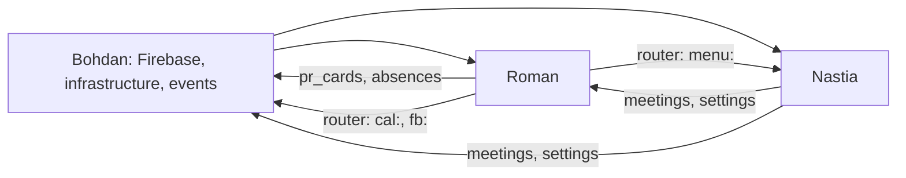

# Tasks and progress

← [Overview](../overview.md)

Each developer owns a separate part; there are no shared tasks. Parts connect through **contracts**: Firestore collection schemas and Discord `custom_id` prefixes, described by their owner.

Task size: **S** — up to a day, **M** — 2–3 days, **L** — a week. Status: ✅ done · 🟡 in progress · ⬜ to do.

## Summary

| Developer | Part | Done |
|---|---|---|
| Developer 1 — Roman | Discord router, PR review, meeting reminders | 11 / 13 |
| Developer 2 — Nastia | mentor panel | 0 / 11 |
| Developer 3 — Bohdan | feedback, analytics, calendar export, infrastructure | 0 / 10 |

## Developer 1 — Roman

**Scope:** the Discord router ([guide](../guides/discord-router.md)), [feature 1 — PR review](../features/01-pr-review.md), [feature 2 — meeting reminders](../features/02-meeting-reminders.md). Task details: [roman.md](roman.md).

| ID | Task | Size | Status |
|---|---|---|---|
| R1 | Discord router | M | ✅ |
| R2 | `pr_cards`, `absences`, `meeting_occurrences` schemas | S | ✅ |
| R3 | Tasks sheet trigger | S | ✅ |
| R4 | PR lookup by task and PR data | M | ✅ |
| R5 | PR card and the "not linked" message | M | ✅ |
| R6 | PR card state | M | ✅ |
| R7 | Resend | S | ✅ |
| R8 | Reminder scheduler, 30 and 5 min | L | ✅ |
| R9 | "I can't attend today" and statuses | M | ✅ |
| R10 | Meeting start and the OK button | S | ✅ |
| R11 | Tests and documentation | M | ✅ |
| R12 | Launch on a real n8n: `.env`, workflow import, public URL, Interactions Endpoint, sheet script | S | ⬜ |
| R13 | Live check of features 1 and 2 with real Discord, GitHub, Firestore and the tasks sheet | M | ⬜ |

R1–R11 are verified by unit tests and an end-to-end run on a real n8n with mocked Discord, GitHub and Firestore.

## Developer 2 — Nastia

**Scope:** [feature 4 — mentor panel](../features/04-mentor-panel.md). Task details: [nastia.md](nastia.md).

| ID | Task | Size | Status |
|---|---|---|---|
| N1 | `meetings`, `meeting_exceptions`, `templates`, `announcements`, `settings`, `access` schemas | M | ⬜ |
| N2 | `/mentor`, pinned panel, access check | S | ⬜ |
| N3 | Menu skeleton and navigation | M | ⬜ |
| N4 | Meetings: creating all three types | L | ⬜ |
| N5 | Meetings: Upcoming, Edit, Cancel | M | ⬜ |
| N6 | Picking participants | M | ⬜ |
| N7 | Templates | M | ⬜ |
| N8 | Announcement | M | ⬜ |
| N9 | Settings | M | ⬜ |
| N10 | Access | S | ⬜ |
| N11 | Tests and documentation | M | ⬜ |

Drafts of `meetings`, `meeting_exceptions` and `settings` already exist in [schema/](../schema/README.md) and are waiting for N1 approval.

## Developer 3 — Bohdan

**Scope:** [feature 3 — feedback](../features/03-feedback.md), analytics, calendar export from [feature 4](../features/04-mentor-panel.md), infrastructure. Task details: [bohdan.md](bohdan.md).

| ID | Task | Size | Status |
|---|---|---|---|
| B1 | Infrastructure | M | ⬜ |
| B2 | `feedback`, `events` schemas | S | ⬜ |
| B3 | Google Form | S | ⬜ |
| B4 | Feedback intake → `feedback` | M | ⬜ |
| B5 | Negative feedback → mentor card | M | ⬜ |
| B6 | Sending the form at the sprint end | S | ⬜ |
| B7 | Grafana: Firestore and the feedback dashboard | L | ⬜ |
| B8 | PR and meeting dashboard | M | ⬜ |
| B9 | Calendar export (`.ics` subscription) | M | ⬜ |
| B10 | Tests and documentation | M | ⬜ |

## Ownership

| | Roman | Nastia | Bohdan |
|---|---|---|---|
| Firestore collections | `pr_cards`, `absences`, `meeting_occurrences` | `meetings`, `meeting_exceptions`, `templates`, `announcements`, `settings`, `access` | `feedback`, `events` |
| Discord prefixes | `pr:`, `mt:` | `menu:`, the `/mentor` command | `cal:`, `fb:` |
| n8n workflows | Discord router; PR review; reminders | mentor panel | feedback; calendar |
| external services | Google Sheets (tasks sheet), GitHub API | Discord (slash command, menu) | Firebase, Google Forms, Grafana, Docker, public URL |
| documentation | `features/01`, `features/02`, `guides/development.md`, `guides/discord-router.md`, `guides/tasks-sheet.md`, own schemas | `features/04`, `guides/mentor-panel.md`, own schemas | `features/03`, `guides/setup.md`, `guides/feedback-form.md`, `guides/grafana.md`, `guides/calendar.md`, own schemas |

## Contracts

The owner describes the schema or format in [`docs/schema/`](../schema/README.md) by the deadline. Others only read data by it.

| Contract | Owner | Used by | Due | Status |
|---|---|---|---|---|
| `meetings`, `meeting_exceptions` schemas | Nastia | Roman (reminders), Bohdan (calendar) | end of week 1 | draft |
| `settings` schema | Nastia | Roman (channels, label → role), Bohdan (thresholds, form) | end of week 1 | draft |
| `pr_cards`, `absences` schemas | Roman | Bohdan (dashboard) | end of week 1 | ✅ |
| `events` schema | Bohdan | everyone writes their events | end of week 1 | ⬜ |
| Discord prefixes and entry point | Roman | Nastia (`menu:`), Bohdan (`cal:`, `fb:`) | end of week 1 | ✅ |
| Firebase credentials, `.env.example` | Bohdan | everyone | end of week 1 | `.env.example` ✅, Firebase ⬜ |

## Mapping to the original assignment

| Original item | Tasks |
|---|---|
| 1. Firebase and Google Sheets templates | B1, B2, R3 |
| 2. Bot and onboarding | N2, N3, N10 (menu and access instead of onboarding) |
| 3. Dailies and reminders | R8–R10, N4–N7 |
| 4. GitHub and PR analysis | R4 |
| 5. PR publishing and notifications | R5–R7 |
| 6. Analytics and Grafana | B7, B8 |
| + feedback form | B3–B6 |
| + announcements and calendar | N8, B9 |
