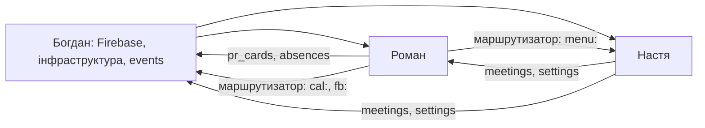

# Таски

← [Огляд](../overview.md)

Кожен розробник веде свою частину окремо, спільних тасок немає. Частини стикуються через **контракти**: схеми колекцій Firestore і префікси кнопок Discord. Їх описує власник.

| Розробник | Частина | Таски |
|---|---|---|
| Роман | [фіча 1 — PR на рев'ю](../features/01-pr-review.md), [фіча 2 — Reminder](../features/02-meeting-reminders.md), маршрутизатор дій Discord | [roman.md](roman.md) |
| Настя | [фіча 4 — меню ментора](../features/04-mentor-panel.md) | [nastia.md](nastia.md) |
| Богдан | [фіча 3 — зворотний зв'язок](../features/03-feedback.md), аналітика, експорт календаря, інфраструктура | [bohdan.md](bohdan.md) |

Розмір таски: **S** — до дня, **M** — 2–3 дні, **L** — тиждень.

## Зони відповідальності

| | Роман | Настя | Богдан |
|---|---|---|---|
| колекції Firestore | `pr_cards`, `absences` | `meetings`, `meeting_exceptions`, `templates`, `announcements`, `settings`, `access` | `feedback`, `events` |
| префікси кнопок Discord | `pr:`, `mt:` | `menu:`, команда `/mentor` | `cal:`, `fb:` |
| n8n workflows | маршрутизатор дій Discord; PR; Reminder | меню ментора | відгуки; календар |
| зовнішні сервіси | Google Sheets (таблиця задач), GitHub API | Discord (slash-команда, меню) | Firebase, Google Forms, Grafana, Docker, публічна адреса |
| документація | `features/01`, `features/02`, `guides/discord-router.md`, `guides/tasks-sheet.md`, свої схеми | `features/04`, `guides/mentor-panel.md`, свої схеми | `features/03`, `guides/setup.md`, `guides/feedback-form.md`, `guides/grafana.md`, `guides/calendar.md`, свої схеми |

## Контракти

Власник описує схему чи формат у [`docs/schema/`](../schema/README.md) до вказаного терміну. Інші лише читають дані за цією схемою.

| Контракт | Власник | Хто використовує | Потрібен до |
|---|---|---|---|
| схема `meetings`, `meeting_exceptions` | Настя | Роман (Reminder), Богдан (календар) | кінця 1-го тижня |
| схема `settings` | Настя | Роман (канали, «лейбл → роль»), Богдан (пороги, форма) | кінця 1-го тижня |
| схема `pr_cards`, `absences` | Роман | Богдан (дашборд) | кінця 1-го тижня |
| схема `events` | Богдан | усі пишуть свої події | кінця 1-го тижня |
| префікси кнопок і точка входу Discord | Роман | Настя (`menu:`), Богдан (`cal:`, `fb:`) | кінця 1-го тижня |
| облікові дані Firebase, `.env.example` | Богдан | усі | кінця 1-го тижня |

## Відповідність початковому ТЗ

| Початковий пункт | Таски | Хто |
|---|---|---|
| 1. Firebase і шаблони Google Sheets | B1, B2, R3 | Богдан, Роман |
| 2. Бот і онбординг | N2, N3, N10 (меню й доступ замість онбордингу) | Настя |
| 3. Дейліки й нагадування | R8–R10, N4–N7 | Роман, Настя |
| 4. GitHub і аналіз PR | R4 | Роман |
| 5. Публікація PR і сповіщення | R5–R7 | Роман |
| 6. Аналітика і Grafana | B7, B8 | Богдан |
| + форма зворотного зв'язку | B3–B6 | Богдан |
| + оголошення й календар | N8, B9 | Настя, Богдан |
